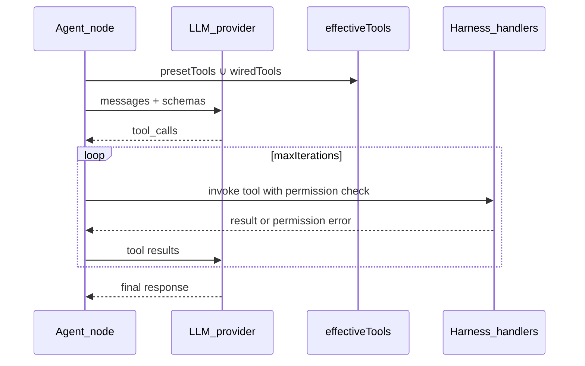

# Node library

## Goal

Give users a set of ready-made building blocks — literals, logic, text
processing, AI agents, filesystem/shell/web access, knowledge base, and web
crawling — so most workflows can be built entirely from built-ins, without
writing a custom node.

## Runtime catalog vs this doc

**Shipped palette nodes** are only those registered in
[`packages/common-nodes/src/catalog.ts`](../../../packages/common-nodes/src/catalog.ts).
See [STATUS.md](../STATUS.md) for the current list.

Much of this file is the **target** product catalog (ports, security model,
rollout). Rows marked **done** historically overstated reality — treat
**`catalog.ts` + STATUS** as truth. A `NODE.md` next to `node.ts` describes
that live node; do not treat a NODE.md footer as “implementation removed.”

| Status word | Meaning here                                        |
| ----------- | --------------------------------------------------- |
| **done**    | In `catalog.ts` and runnable                        |
| **stub**    | `NODE.md` (and maybe helpers) only — not registered |
| **planned** | Spec / epic; not implemented                        |

**Catalog Status ≠ use-case Status.** A palette row can be `done` while a
use case stays Partial because a capability is still missing. Text-only LLM

- HITL plus the harness tool loop are enough for
  [coding-agent](../use-cases/coding-agent.md) to be **Available**. The
  sample graph and its prompts are user configuration.

**Product lock (LLM):** one node type (`common-openai-llm` /
`common-fake-llm`) with **role presets** (Plan/Coder/Explorer) — not separate
`common-agent-*` palette types. See [LLM_NODES.md](../../reference/LLM_NODES.md).

## Core Principles

- **Batteries included, sandboxed by default** — every node that touches the
  filesystem, shell, or network runs on the server under a project-root
  sandbox; nothing reaches outside the project directory or the user's
  explicit permission rules.
- **Typed ports everywhere** — every node's inputs/outputs declare a wire
  type; the palette and canvas enforce the same compatibility rules for
  built-in and custom nodes alike.
- **The environment decides, not just the model** — "hard harness" nodes
  (Assert, Gate, IF, Switch, Review, HITL) let a workflow branch on verifiable
  conditions instead of trusting an LLM's self-report.
- **Composable, not monolithic** — harness capabilities (read file, web
  fetch, grep, …) exist both as standalone palette nodes and as tools an
  Agent node can call — a user is never forced to go through an agent to use
  a capability.
- **No silent path/URL escapes** — path and network access nodes validate
  every path against the project root and every request against basic SSRF
  guards; this is a deliberate reaction to real-world node-based-tool CVEs.

## Feature Details

**Target** palette groupings (not all shipped — see Runtime catalog above):

- **AI / Agents (target)** — LLM with Plan/Coder/Explorer **presets**, Review /
  Critique nodes, Review Gate, Chat Input. Today: LLM + internal tool-loop +
  `common-review` / `common-critique`
    - HITL; role profiles and Chat Input remain epics. Chat Input — see
      [hitl-chat.md](hitl-chat.md).
- **Logic** — Router + Merge + Assert / IF / Switch / Compare / Gate
  **shipped** (hard harness).
- **Flow** — Delay + Checkpoint + Loop + Repeat **shipped**.
- **Text** — Concat + Split (paced) + Read/Write/Append File **shipped**;
  Template, one-shot Split (`parts[]`), Replace, … planned/stub.
- **Primitives** — String, String (multiline), Number, Boolean **shipped**;
  JSON helpers planned.
- **Output** — Preview + Hint + Tool inspect + Finish **shipped**.
- **Harness (target)** — Read/List/Glob/Grep/Web Fetch/Write/Edit/Bash as
  palette nodes and/or agent tools — **not shipped** (epic 01).
- **Embeddings** — Embed text, Embed similarity, Embed provider (`EmbedHandle`
  wire for custom packs) — epic 42 **landed**.
- **Memory** — `common-memory-tools` → `.langflower/memory/` (markdown tools
  plus `update_plan` / `read_plan` and a `plan` work-log output; not vector KB —
  [ADR-033](../../adr/033-markdown-memory-tools-no-embedding-as-base.md)).
- **Knowledge / Crawl** — vector KB pipeline **removed** (ADR-033); crawl nodes
  (epic 12) in catalog.

A typical "hard harness" pipeline chains agent and gate nodes so a step's
success is verified before the next step runs, e.g.:
Plan → Assert(plan valid) → [fail: Refine] / [pass: Implement] → Assert(tests
pass) → Review → QA.

**Historical:** vector KB graph nodes (`common-kb-*`) were removed (ADR-033).
Use **Embeddings** catalog nodes + pack-owned storage, or markdown memory tools.

A typical **Embeddings** manual check is `String → common-embed-text → Preview`
on **`preview`**, optionally `vector → common-embed-similarity`. Custom packs
wire `common-embed-provider.embed → consumer.embed` (`EmbedHandle`).

Every harness node that reads/writes files or makes HTTP requests is
constrained to the current project's root directory, denies a default list
of sensitive paths (e.g. `.env`, git config), and applies allow/ask/deny
permission rules a user configures per project (see
[project-configuration.md](project-configuration.md)).

## Implementation Details

- Node package layout and reactive-binding conventions:
  [packages/common-nodes/AGENTS.md](../../../packages/common-nodes/AGENTS.md).
- Author conventions for adding a new built-in or custom node (folder layout,
  ports, tests): [docs/reference/NODES.md](../../reference/NODES.md), reactive SDK reference in
  [packages/node-sdk/AGENTS.md](../../../packages/node-sdk/AGENTS.md).
- Harness sandbox and permission resolution: **planned** under
  `packages/server/src/harness/` (directory not present yet — epic 01);
  summarized in [docs/architecture/ARCHITECTURE.md](../../architecture/ARCHITECTURE.md) when landed.
- Custom user-authored nodes (distinct from this built-in catalog): see
  [getting-started.md](getting-started.md) and `spec.md` §4.

The rest of this document is the full built-in node catalog — per-node port
reference, security model, rollout status, and design history — kept in one
place instead of a separate spec file. Related background docs:
[docs/architecture/EXECUTION_ARCHITECTURE.md](../../architecture/EXECUTION_ARCHITECTURE.md) (runtime
execution), [docs/reference/REACTIVE_NODES.md](../../reference/REACTIVE_NODES.md) (reactive SDK and
port telemetry), [docs/reference/CONFIG.md](../../reference/CONFIG.md) (LLM + embedding providers, harness
permissions), [docs/guides/TESTING.md](../../guides/TESTING.md) (integration harness, WS
client), [docs/product/STATUS.md](../STATUS.md) (implementation status).

---

## 1. Product vision

Langflower provides UX similar to [OpenCode](https://opencode.ai/docs/tools/), but
with **explicit visual chaining** instead of a hidden tool loop.

| OpenCode (CLI)                       | Langflower (visual)                                                                                          |
| ------------------------------------ | ------------------------------------------------------------------------------------------------------------ |
| Agent modes (plan, build, review)    | Workflow phases wired as nodes + gates                                                                       |
| Built-in tools (read, grep, glob, …) | **Harness** common nodes                                                                                     |
| Permission config                    | `langflower.jsonc` `permission` + agent presets                                                              |
| Human questions                      | **Review Gate** + default agent builtin `ask_user` (question in feed; composer Send + optional option chips) |
| Feedback in chat                     | **Feedback edges** → LLM rerun                                                                               |

### Hard harness

The environment — not the LLM alone — decides whether a step succeeded and which
branch runs next:

1. **Assert** / **Gate** nodes evaluate conditions (tests passed, schema valid, grep found pattern).
2. Failed assert → node error → executor marks branch failed; workflow routes via **IF** / **Switch**.
3. **Review Gate** pauses for human input; **feedback** edges trigger LLM refinement.

Typical agent pipeline:

```
Plan (LLM) → Assert(plan schema) → [fail] → Refine (LLM + feedback)
            → [pass] → Implement (LLM + harness tools) → Assert(tests)
            → [pass] → Review (LLM) → Assert(checklist) → QA (Bash/tests) → Done
```

---

## 2. Node retirement policy

The retirement policy is in [node-library-retirement.md](node-library-retirement.md).

## 3. Design principles

1. **Common-node ownership** — built-in definitions live in
   `packages/common-nodes/src/` and use the public
   `@langflower/node-sdk` SDK.
2. **Injected runtime I/O** — file, shell, HTTP, KB, crawl capabilities are
   implemented in `@langflower/tools` and exposed through the run
   `ExecutionContext`; common nodes compose those injected capabilities.
3. **Project-root sandbox** — harness paths resolve under `<project-root>/`
   (parent of `.langflower/`), or under `harness.allowedRoots` when set
   (ADR-014 extension — Obsidian vaults outside the project). Paths outside
   every fence → error. No silent deny.
4. **Typed ports** — primitives use `string` / `number` / `boolean` wire
   types; runtime/editor port metadata and canvas connection checks enforce
   compatibility.
5. **Immutable definitions** — `readonly` ports and params per [PRINCIPLES.md](../../architecture/PRINCIPLES.md).
6. **Security lessons** — Flowise removed read/write file tools after path-traversal CVEs; Langflower validates every path (see [§10](#10-security--permissions)).

---

## 4. Node spec template

Every common node is documented with:

| Field                | Description                                                       |
| -------------------- | ----------------------------------------------------------------- |
| `type`               | Stable id, prefix `common-`                                       |
| `displayName`        | Palette label                                                     |
| `category`           | Palette group (see [§9](#9-palette-categories))                   |
| `inputs` / `outputs` | Port names, wire types, defaults, cardinality, feed / passthrough |
| `uiSchema`           | Inspector parameters; use `as const` for inferred params          |
| `bind`               | Builds the `StatefulConnection` / `StatefulObservable` graph      |
| `serverRuntime`      | Required injected `ExecutionContext` capabilities, if any         |
| `priority`           | P0 / P1 / P2                                                      |
| `status`             | `done` \| `stub` \| `planned`                                     |

Implementation uses `defineReactiveNode` from
`@langflower/node-sdk`. `defineReactiveNode` first probes `bind` for
serializable port metadata; every `getInstance()` calls `bind` again for a
fresh live graph. Therefore `bind` must not perform module-level I/O or mutate
shared state.

Use `makeInput`, `configureOutput`, and `combineInputs` from the bind helpers.
Optional initialization inputs declare `defaultValue`; only ordered feedback
turns use the `startWith('')` + `concatMap` pattern. Passthrough outputs pass
the input connection directly and set `inferTypeFrom` so both demand and
dynamic wire typing stay explicit.

For `StatefulObservable` semantics, pure folds, subscription boundaries, and
the `withLatestFrom` restriction, reference
[REACTIVITY.md](../../architecture/REACTIVITY.md) rather than duplicating those rules here.
Full examples:
[HOW_TO_WRITE_REACTIVE_NODES.md](../../guides/how-to-write-reactive-nodes.md).

---

## 5. Production nodes (current)

The production node list is in [node-library-production.md](node-library-production.md).

## 6. Primitives category

Replace `common-constant` with three typed nodes. **Priority P0** · **Status:** done

Primitives are **reactive** nodes with a single `value` input port carrying the
literal — `inline` on that port drives the on-node editor (`lf-node-port-row` /
`InlineConfig`, see [packages/ui/AGENTS.md](../../../packages/ui/AGENTS.md)). No wire
is required: an unconnected port seeds from `defaultValue`. The output passes
the input straight through.

### 6.1 String — `common-string`

| Input   | Type   | `inline` | Default |
| ------- | ------ | -------- | ------- |
| `value` | string | `'text'` | `''`    |

| Output  | Type   |
| ------- | ------ |
| `value` | string |

### 6.2 Number — `common-number`

| Input   | Type   | `inline` | Default |
| ------- | ------ | -------- | ------- |
| `value` | number | `'text'` | `0`     |

| Output  | Type   |
| ------- | ------ |
| `value` | number |

### 6.3 Boolean — `common-boolean`

| Input   | Type    | `inline`    | Default |
| ------- | ------- | ----------- | ------- |
| `value` | boolean | `'boolean'` | `false` |

| Output  | Type    |
| ------- | ------- |
| `value` | boolean |

### 6.4 String (multiline) — `common-string-multiline`

Same passthrough as String; the on-node editor is a textarea.

| Input   | Type   | `inline`           | Default |
| ------- | ------ | ------------------ | ------- |
| `value` | string | `'text-multiline'` | `''`    |

| Output  | Type   |
| ------- | ------ |
| `value` | string |

**Migration:** workflows using `common-constant` map `params.value` → `common-string`
with the same value moved to `inputs.value`. Numeric/boolean literals require
explicit node type.

---

## 7. Catalog by category (status vs `catalog.ts`)

The catalog table is in [node-library-catalog.md](node-library-catalog.md).

## 8. P0 node port reference

The port reference is in [node-library-ports.md](node-library-ports.md).

## 9. Palette categories

Runtime Level-2 labels come from each node's `category` (`AI`, `Tools`,
`HITL`, `Flow`, …). Historical / aspirational names may still appear in older
sections of this file — treat `catalog.ts` + this table as the palette SoT.

| Section        | Nodes (shipped grouping)                                                      |
| -------------- | ----------------------------------------------------------------------------- |
| **AI**         | OpenAI LLM, Fake LLM, Sub-Agent, Review, Critique                             |
| **Embeddings** | Embed text, Embed similarity, Embed provider                                  |
| **Tools**      | MCP stdio, MCP http, Memory Tools, Crawl Tools, Tool collection, Tool invoke  |
| **Primitives** | String, String (multiline), Number, Boolean, Set Fields, JSON Parse/Stringify |
| **Flow**       | Router only (primary)                                                         |
| **Text**       | Concat, Split (paced), Read/Write/Append File; Template, Split, Replace…      |
| **Output**     | Preview, Hint, Tool inspect, Run Output                                       |
| **HITL**       | Review Gate, Chat Loop, Chat Input                                            |
| **Advanced**   | `paletteSecondary: true` — Logic (all), Flow except Router, Crawl graph I/O   |

**Dual-surface / secondary (normative):** [ADR-023](../../adr/023-palette-palettesecondary-collapsed-advanced.md).
Primary **Tools** holds MCP wire nodes, tool registration packs
(`memory-tools`, `crawl-tools`), optional **Tool collection**, and
**Tool invoke**. Entire
**Logic** and all **Flow** nodes except Router set `paletteSecondary: true`
and appear under **Advanced**, subdivided by original `category`. Crawl graph
I/O stays Advanced under **Crawl**. Prefer packs → agent `tools`
(MECHANICS C5 (`docs/_archive/DONE/EPICS/MECHANICS-tool-execution.md`)).

No **Debug** section in production palette.

UI sidebar: `packages/ui/src/app/features/palette/` — Level 1 by
`PaletteNodeDefinition.source` (`system` | `custom`); Level 2 by node
`category`, plus collapsed **Advanced** for `paletteSecondary`.

---

## 10. Security & permissions

### 10.1 Project-root sandbox

- **Root** = directory passed to `langflower start [project-dir]` (parent of `.langflower/`).
- Resolve: `path.resolve(root, userPath)` must stay under `root` (no `..`, no symlink escape).
- Default **deny list** (readable paths blocked): `.env`, `.env.*`, `**/.git/config`, `**/credentials*`.
- Configurable in `langflower.jsonc` under `harness.denyPaths` (planned).

### 10.2 SSRF (Web Fetch / Crawl)

- Deny RFC1918, link-local, metadata IPs by default.
- Optional `harness.allowedHosts` allowlist for crawl/fetch.

### 10.3 Bash

- Default / first-run floor: **`allow`** (all builtins). Harden via project
  `permission.bash` when needed.
- Node Inspector **Tool permissions** table (`tool | deny | ask | allow`) sets
  per-agent `toolPermissions`; effective = stricter(project floor, node).
  Floor deny hides the row; floor ask hides the allow radio.
- Coder preset materializes `bash: ask`; Plan/Explorer materialize `bash: deny`.
  No hidden role overlay at runtime.
- Deny without ask returns a tool error that cites policy.
- UI approval when policy is `ask` — HITL composer Allow/Deny.

### 10.4 Glob / Grep

- Backend uses ripgrep (or equivalent) with **`.gitignore` honoured by default**.
- Param `respectGitignore` (boolean, default `true`) on Glob and Grep nodes.

### 10.5 Flowise lesson

Read/Write file tools were removed from Flowise after directory-traversal RCEs.
Langflower never exposes raw paths to the LLM without server-side validation.

---

## 11. Agents, tool loop, and harness wiring

### 11.1 Two ways to use harness capabilities

| Mode                        | Use case                                                      |
| --------------------------- | ------------------------------------------------------------- |
| **Agent preset node**       | Opinionated tool set + permissions (Plan / Coder / Explorer)  |
| **Standalone harness node** | Explicit step in the graph (`Read File` → `Template` → `LLM`) |
| **Agent + wired harness**   | Extend preset with extra tools via `tools` port               |

### 11.2 Tool loop (inside agent nodes)



Agent nodes run the full tool loop server-side (`execute-agent`). Harness tool
nodes export `tool-registration`; wire to agent `tools` (multi).

### 11.3 Tool manifest (harness → agent)

Each harness node publishes a stable tool id:

| Harness node | Tool id      | Typical LLM tool name |
| ------------ | ------------ | --------------------- |
| Read File    | `read_file`  | `read_file`           |
| List Files   | `list_files` | `list_files`          |
| Glob         | `glob`       | `glob`                |
| Grep         | `grep`       | `grep`                |
| Web Fetch    | `web_fetch`  | `web_fetch`           |
| Write File   | `write_file` | `write_file`          |
| Edit File    | `edit_file`  | `edit_file`           |
| Bash         | `bash`       | `bash`                |
| sleep        | `sleep`      | `sleep` (default)     |
| ask_user     | `ask_user`   | `ask_user` (default)  |

Wiring: edge from harness output `toolRegistration` (`wireType: **tool-registration**`,
**multi** on agent `tools`) → agent input `tools`.

`tool-registration` payload shape (immutable record):

```ts
{
  readonly toolId: string;       // LLM function name (e.g. "grep")
  readonly name: string;         // display / alias
  readonly description: string;
  readonly inputSchema: object; // JSON Schema
  readonly handler?: ToolHandler; // pack/custom tools; builtins may omit
}
```

Pack/custom tools attach `handler` at authoring time (import from
`@langflower/tools/domain-tool-configs` or define locally). The internal tool
loop calls `registration.handler(args, toolCtx)`. Builtins omit `handler` and
use `harness.invoke`. There is **no** closed harness `toolId` → handler map for
domain tools ([ADR-019](../../adr/019-toolhandle-invocation-not-harness-toolid-registry.md)).

Standalone harness nodes still run in batch order when not wired to an agent.

### 11.4 Permission merge order

1. Global `langflower.jsonc` → `permission.*`
2. Agent preset profile (Plan / Coder / Explorer)
3. Path-specific rules on the tool call (e.g. write target `*.md`)

Denied call → tool result error to LLM; repeated failures can trigger Assert downstream.

### 11.5 Embedding provider (catalog)

Settings default + catalog Embeddings nodes. See
[CONFIG.md § Embeddings](../../reference/CONFIG.md#embeddings). Effective identity is
`embedding: "providerId/modelId"` (distinct from chat `model`). `common-embed-text`
and `common-embed-provider` call `POST /v1/embeddings` via server-bound
credentials; empty panel fields fall back to the Settings default.
`common-embed-provider` emits `EmbedHandle` on wire type `embed-handle` for custom
packs — **not** `ToolHandle`. Similarity is offline cosine only.

---

## 12. Migration from early demo nodes

| From                           | To                 | Notes                                                      |
| ------------------------------ | ------------------ | ---------------------------------------------------------- |
| `common-constant`              | `common-string`    | `params.value` moves to `inputs.value` for string literals |
| `common-collect`               | `common-join`      |                                                            |
| `common-delay`                 | —                  | Remove                                                     |
| `common-triple`                | —                  | Remove; update reactive tests                              |
| `common-flaky`, `common-throw` | test fixtures only | Not in palette                                             |

Keep `router-two-channels.json` fixture. Remove or rewrite `triple-emit.json`,
`delay-preview.json`, `throw-preview.json`.

---

## 13. Sample workflows

### 13.1 Shipped sample workflows

First-run bootstrap copies only the **minimum** skeleton workflow
(`starter.json`) when missing — see [skeleton](skeleton.md) /
[bootstrap-new-project](../use-cases/bootstrap-new-project.md). Catalog
samples (`node-writer`, `agents-dialog`, `simple-coder`, `advanced-coder`)
live under `packages/server/skeleton/workflows/` and are **not** auto-copied.
Demo-project still holds dogfood workflows (e.g. `basic-coder`, `example`)
for CI / local exploration.

Seed logic: `packages/server/src/bootstrap/project-bootstrap.service.ts`.

Linear chat with human refinement (`simple.json`):

```
[String] ──userPrompt──► [LLM] ──response──► [Review Gate]
                              ▲                    │
                              └── feedback ────────┘
```

Use the **mock LLM provider** (see [§14](#14-mock-llm-chain-testing)) to run these
workflows without API keys. Agent samples use `promptContains` entries in
`.langflower/mock-llm.json` (seeded from `mock-llm.json.tpl`).

### 13.2 Coder workflow — `coder.json`

```
[Goal] ──userPrompt──► [Coder Agent] ◄──tools── [Grep]
[Search pattern] ──pattern──► [Grep]
```

Default `systemPrompt` and `skills`: [§20.2](#202-coder-agent--common-agent-coder).

### 13.3 Explorer workflow — `explorer.json`

```
[Topic] ──userPrompt──► [Explorer Agent] ◄──tools── [Web Fetch]
[Seed URL] ──url──► [Web Fetch]
```

Defaults: [§20.3](#203-explorer-agent--common-agent-explorer).

### 13.4 Hard harness plan → QA (sketch)

```json
{
	"nodes": [
		{
			"id": "goal",
			"type": "common-string",
			"data": { "inputs": { "value": "Add login form" } }
		},
		{ "id": "plan", "type": "common-agent-plan", "data": { "params": {} } },
		{
			"id": "assert-plan",
			"type": "common-assert",
			"data": { "params": {} }
		},
		{
			"id": "implement",
			"type": "common-agent-coder",
			"data": { "params": {} }
		},
		{
			"id": "test",
			"type": "common-bash",
			"data": { "params": { "command": "npm test" } }
		},
		{
			"id": "assert-tests",
			"type": "common-assert",
			"data": { "params": {} }
		}
	],
	"edges": [
		{
			"source": "goal",
			"sourcePort": "value",
			"target": "plan",
			"targetPort": "userPrompt"
		},
		{
			"source": "plan",
			"sourcePort": "response",
			"target": "assert-plan",
			"targetPort": "value"
		},
		{
			"source": "assert-plan",
			"sourcePort": "value",
			"target": "implement",
			"targetPort": "userPrompt"
		},
		{
			"source": "test",
			"sourcePort": "exitCode",
			"target": "assert-tests",
			"targetPort": "condition"
		}
	]
}
```

(Node ids and assert wiring simplified; real graphs need Compare nodes for `exitCode === 0`.)

### 13.5 KB ingest + query (planned)

```
Glob(**/*.md) → Read File → KB Ingest → KB Embed
common-string (question) → KB Search → LLM (userPrompt + context)
```

---

## 14. Mock LLM (chain testing)

`common-fake-llm` is a shipped reactive canvas stand-in. It streams
deterministic `reasoning` and `draftResponse` values before its final
`response`, and reports wired `tool-handle` inventory in reasoning. It does not impersonate a provider or read a hidden
script file.

It imitates an LLM in tests and in showcase workflows when a real completion
does not pay: a live model costs money and is not deterministic.

Use it to exercise the real graph, runtime, WebSocket telemetry, work log, and
HITL projections without an API key:

```text
workflow → RuntimeFacade → common-fake-llm
         → runner.port ('out') → execution feed / canvas chrome
```

Implementation and coverage:

- `packages/common-nodes/src/ai/nodes/fake-llm/node.ts`
- `packages/common-nodes/src/ai/nodes/fake-llm/node.test.ts`
- `tests/integration/ws/execute-fake-llm.ws.test.ts`
- `tests/integration/ws/execute-fake-llm-debate-loop.ws.test.ts`

OpenAI-compatible adapter tests may still use an explicit HTTP fake when the
provider boundary itself is under test; that is separate from
`common-fake-llm`.

---

## 15. Wire types (extensions)

Wire types are declared by node/runtime port metadata. Add a new semantic wire
type only when a concrete node needs it and update every connection-validation
boundary in the same change. A port may also declare a **list** of wire
types (a union): an edge connects when the two sides share a member, and the
canvas shows `string | user-turn`
([ADR-043](../../adr/043-union-wire-types-connect-on-a-shared-member.md)).

| Type                | Use                                                   |
| ------------------- | ----------------------------------------------------- |
| `tool-registration` | Harness → Agent `tools` (multi); tool manifest record |
| `embed-handle`      | Embed provider → pack consumer; live `EmbedHandle`    |
| `file-path`         | Relative path within project root                     |
| `url`               | Validated HTTP(S) URL                                 |
| `phase`             | `plan` \| `refine` \| `implement` \| `review` \| `qa` |

Do not document a single `canConnectPorts` owner: no such public API currently
exists. Runtime/editor and canvas validation must agree on any extension.

---

## 16. Delivery tracking (no Stage labels)

Historical **Stage 1 / 2 / 3** rollout text was deleted — it was outdated after
epics 00–16 landed.

| Need                          | Where                                                                         |
| ----------------------------- | ----------------------------------------------------------------------------- |
| Product purpose / north star  | [PRODUCT.md](../PRODUCT.md)                                                   |
| End-user readiness            | [use-cases/](../use-cases/README.md)                                          |
| Completed capability plans    | DONE/EPICS/README.md (`docs/_archive/DONE/EPICS/README.md`)                   |
| Built-in vs custom node load  | [ADR-020](../../adr/020-built-in-vs-custom-node-loading.md)                   |
| Project-root harness I/O      | [ADR-014](../../adr/014-project-root-harness-i-o.md)                          |
| Tool handlers on registration | [ADR-019](../../adr/019-toolhandle-invocation-not-harness-toolid-registry.md) |

---

## 17. Feature roadmap

Track delivery in DONE/EPICS/README.md (`docs/_archive/DONE/EPICS/README.md`) and open
use-case gaps in [use-cases/README.md](../use-cases/README.md).

**Critical path (product):** full [coding-agent](../use-cases/coding-agent.md)
pipeline → Available (basic Plan→Coder is smoke only).

Capability epics 01–16 are archived under DONE; do not reopen as a Stage DAG.

---

## 18. References

| Source                                                                         | Relevant patterns                             |
| ------------------------------------------------------------------------------ | --------------------------------------------- |
| [n8n Core nodes](https://docs.n8n.io/integrations/builtin/core-nodes/)         | Set, IF, Switch, Merge, HTTP Request          |
| [n8n LangChain nodes](https://docs.n8n.io/integrations/builtin/cluster-nodes/) | Agent + tools + vector store (concept only)   |
| [OpenCode tools](https://opencode.ai/docs/tools/)                              | read, glob, grep, apply_patch, bash, webfetch |
| [OpenCode agents](https://opencode.ai/docs/agents/)                            | plan/build modes, permission keys             |
| Flowise CVE history                                                            | Mandatory path sandbox for file tools         |

---

## 19. Resolved decisions

| Topic                 | Decision                                                                                                                                                |
| --------------------- | ------------------------------------------------------------------------------------------------------------------------------------------------------- |
| Tool loop wiring      | **Agent preset nodes** (Plan/Coder/Explorer) with bundled tools; harness nodes connectable via `tools`                                                  |
| Embedding provider    | **`embedding: "providerId/modelId"`** in config + Embeddings catalog nodes — [CONFIG § Embeddings](../../reference/CONFIG.md#embeddings); not vector KB |
| KB vector storage     | **Removed** — ADR-033; use markdown memory tools + optional pack-owned indexes via `EmbedHandle`                                                        |
| Glob / Grep           | **Respect `.gitignore` by default** (ripgrep)                                                                                                           |
| Bash                  | **`deny` by default**; **`ask`** where agent preset allows (Coder); configurable patterns in `langflower.jsonc`                                         |
| Write / edit / create | **`allow` by default**; `delete` **`ask`**; Plan/Explorer postures still tighten                                                                        |
| Structured output     | **`structuredOutput` param** on agent and Review nodes — not a separate node type                                                                       |
| Rollout / roadmap     | **Use-case Status** (Partial → Available) — [PRODUCT.md](../PRODUCT.md); no Stage 1/2/3                                                                 |
| Switch outputs        | **Dynamic output ports** from `rules` param                                                                                                             |
| `tools` wiring        | Wire type **`tool-handle`** / **`tool-registration`**, **multi** port on agent                                                                          |
| `embed` wiring        | Wire type **`embed-handle`** — live `EmbedHandle`; not agent inventory                                                                                  |

## 20. Open questions

(none blocking P0 — revisit for Custom Agent and Sub-Agent.)

---

## 21. Agent defaults (system prompts & skills)

Agent nodes ship with editable defaults in `node.data.params`:

| Param           | Type   | Notes                                                |
| --------------- | ------ | ---------------------------------------------------- |
| `systemPrompt`  | string | Panel + multiline; user can override                 |
| `skills`        | json   | string[] — markdown skill blocks appended at runtime |
| `maxIterations` | number | default per preset                                   |

Runtime message assembly:

```
effectiveSystem = systemPrompt + "\n\n---\n\n" + skills.join("\n\n---\n\n")
```

### 20.1 Plan Agent — `common-agent-plan`

**Default `systemPrompt`:**

```markdown
You are the Plan agent in a Langflower workflow.

Understand the user's goal, explore the codebase read-only, and produce a clear
implementation plan. Do not modify source code or non-documentation files.

Write plans in Markdown with sections: Goal, Context, Steps, Risks, Open questions.

When memory tools are wired, call update_plan with that markdown so the operator
sees the current plan in the work log. There is no separate Plan mode.

When requirements are ambiguous, use ask_user before finalizing the plan.
You may pass ordered questions with options; the operator can pick chips or type.
To wait without bash, call sleep with seconds from 1 to 300. Do not busy-loop. Stop aborts the wait.
```

**Default `skills`:**

```json
[
	"Exploration: use glob and grep to locate relevant files before reading. Read only what you need.",
	"Planning: keep steps small and testable. Note dependencies between steps.",
	"Documentation: you may write or update *.md and docs/** to capture the plan."
]
```

| Param           | Default |
| --------------- | ------- |
| `maxIterations` | 15      |

### 20.2 Coder Agent — `common-agent-coder`

**Default `systemPrompt`:**

```markdown
You are the Coder agent in a Langflower workflow.

Implement the requested changes in the project repository. Make minimal, correct
edits. Prefer precise file edits over large rewrites.

When tests are available, run them to verify your work. Summarize what you changed
in your final response.

If you are not sure, call ask_user instead of guessing.
You may pass ordered questions with options; the operator can pick chips or type.
To wait without bash, call sleep with seconds from 1 to 300. Do not busy-loop. Stop aborts the wait.
```

**Default `skills`:**

```json
[
	"Before editing: read the file regions you will change.",
	"After editing: run the project test command (e.g. npm test) when bash is allowed.",
	"Do not commit, push, or change git state unless the user explicitly asks."
]
```

| Param           | Default |
| --------------- | ------- |
| `maxIterations` | 25      |

### 20.3 Explorer Agent — `common-agent-explorer`

**Default `systemPrompt`:**

```markdown
You are the Explorer agent in a Langflower workflow.

Research the topic using web_fetch. Synthesize findings into clear Markdown notes.
Do not modify application source code—only \*.md research notes.

Cite URLs. Separate facts from inference.

If you are not sure, call ask_user instead of guessing.
You may pass ordered questions with options; the operator can pick chips or type.
To wait without bash, call sleep with seconds from 1 to 300. Do not busy-loop. Stop aborts the wait.
```

**Default `skills`:**

```json
[
	"Web: prefer primary sources; note retrieval date when relevant.",
	"Notes: save under notes/ or docs/research/ unless the user specifies a path.",
	"Scope: answer the stated goal; list follow-up questions if the topic is broad."
]
```

| Param           | Default |
| --------------- | ------- |
| `maxIterations` | 12      |

### 20.4 UI behaviour

- On palette drop, agent nodes load defaults into `params.systemPrompt` and `params.skills`.
- Sample workflows (`simple.json`, `plan.json`, `coder.json`, `explorer.json`) ship on bootstrap; see [§13](#13-sample-workflows).
- Skills render as a collapsible list in the node params panel (editable strings).

---

## 22. Code map

| Area                       | Path                                                                       |
| -------------------------- | -------------------------------------------------------------------------- |
| Common node definitions    | `packages/common-nodes/src/`                                               |
| Router node                | `packages/common-nodes/src/flow/router/`                                   |
| Catalog resolution         | `packages/common-nodes/src/catalog.ts`                                     |
| Runtime session            | `packages/server/src/session/langflower-session.ts`                        |
| Runner intent wiring       | `packages/server/src/bridge/wire-runner-handlers.ts`                       |
| LLM nodes and adapters     | `packages/common-nodes/src/ai/`                                            |
| HITL inject (bridge)       | `packages/server/src/bridge/wire-runner-handlers.ts` (`runner.hitl.event`) |
| Harness capabilities       | `packages/tools/src/`                                                      |
| Bootstrap sample workflows | `packages/server/src/bootstrap/project-bootstrap.service.ts`               |
| Fake LLM node              | `packages/common-nodes/src/ai/nodes/fake-llm/node.ts`                      |
| Fake LLM integration tests | `tests/integration/ws/execute-fake-llm.ws.test.ts`                         |
| Palette UI                 | `packages/ui/src/app/features/palette/`                                    |
