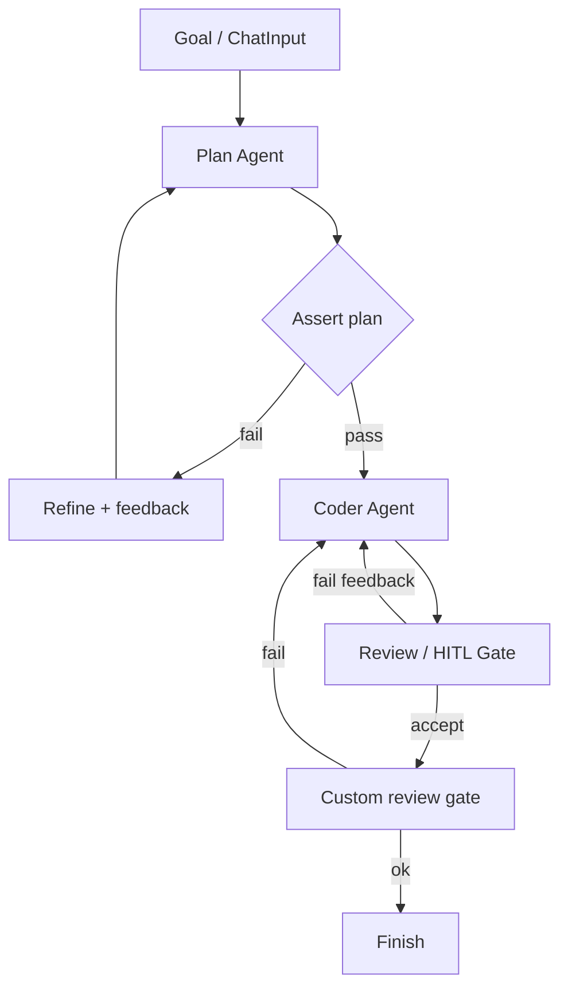

# Plan → refine → implement → review → QA

**Status:** Available — QA is a custom node written with
`defineReactiveNode` from `@langflower/node-sdk`. It runs the checks and
returns failure text on `fail` into the agent `feedback`. `ok` continues
the graph. Dogfood `lf-review-gate` is that pattern: format, then
typecheck, then test. `basic-coder` HITL smoke is a different graph.

## Value

Ship a small code change through a **hard-harness** graph: plan, implement,
review, then a custom gate that runs the real checks and sends failures
back on `feedback` — **not** on the model saying the work looks good.
The gate is a node authored with `defineReactiveNode`, not a chat turn.

## UX scenarios

### S1 — Start a hard-harness plan→QA run

**Who:** Developer who needs verifiable gates on plan and tests.

**Want:** A graph whose QA node runs the checks and will not advance on the
model's say-so.

**Do:** Wire Plan → Coder → a custom review gate (`defineReactiveNode`).
`ok` continues. `fail` returns the failure text to the agent `feedback`.
Dogfood `lf-review-gate` runs format, then typecheck, then test.

**Expect:**

- The QA stage MUST be a custom gate (`defineReactiveNode`): `ok`
  continues, `fail` returns the check text on `feedback`. HITL Accept
  alone MUST NOT be that gate.
- Model prose (“LGTM”, “tests pass”) alone MUST NOT count as the QA pass.
- [Feed](../features/feed-panel.md) shows the gate's `fail` text when the
  checks do not pass.

### S2 — Plan Assert fails closed before Coder

**Who:** Same developer when the plan fails a verifiable check.

**Want:** A bad plan stops implementation — not a soft “looks fine” continue.

**Do:** Let Plan emit a plan; let Assert (schema / required sections via
Compare condition) evaluate it. Inspect the failed gate on the canvas /
inspector if needed.

**Expect:**

- Assert fail MUST block Coder — Coder MUST NOT receive the failed plan as a
  pass handoff.
- Fail MUST open the refine path (feedback / Refine → Plan) — MUST NOT
  silent-continue to Coder.
- Feed MUST surface the failed plan Assert (which hard gate stopped progress).

### S3 — Refine until plan Assert passes

**Who:** Same developer on the refine loop.

**Want:** Revision as graph structure until Assert passes or a max Gate fails
the branch.

**Do:** Observe Refine (or Plan + feedback) re-enter; wait for Assert pass or
Gate cap.

**Expect:**

- Refine / feedback MUST re-enter Plan or Coder on a visible edge.
- A pass MUST be the gate's `ok` (or an Assert the author wired) — MUST
  NOT be the model declaring the plan ready in prose.
- How many times the author lets that edge fire is their graph.

### S4 — Implement only after plan Assert pass

**Who:** Same developer after the plan gate opens.

**Want:** Coder implements against an Assert-accepted plan, under project
permissions.

**Do:** After plan Assert pass, let Coder (`rolePreset: coder`) run the
harness tool loop; Allow / Deny `permission.ask` in the feed/composer when
policy requires it.

**Expect:**

- Coder MUST start only after plan Assert pass (edge after the hard gate).
- Coder MUST enter the harness tool loop (`read` … `bash` as policy allows).
- Destructive or shell actions under ask policy MUST surface as
  `permission.ask`; Allow/Deny MUST continue or block that tool call.

### S5 — Review accept or feedback before QA

**Who:** Same developer after Coder produces a change.

**Want:** Accept or send revision notes as graph ports — not an informal chat
aside.

**Do:** At Review (`common-review` or `common-hitl-review-gate`): Accept to
advance toward QA, or send feedback to Coder.

**Expect:**

- Review fail / feedback MUST route to Coder.`feedback` (revision visible on
  the canvas).
- Accept MUST continue to the QA gate — MUST NOT Finish from Review alone
  (the custom gate's `ok` is required downstream in this Value).
- HITL Approve / Send feedback MUST use the
  [HITL chat](../features/hitl-chat.md) / composer control surface when a
  Review Gate is in the graph.

### S6 — QA gate returns failures on feedback

**Who:** Same developer after Review accept.

**Want:** Tests and typecheck as a hard gate. Done only when the gate
passes. A failure comes back as text the agent can fix.

**Do:** Run the custom review gate. `ok` continues toward Finish. `fail`
sends the stripped failure text to Coder `feedback`.

**Expect:**

- The gate MUST run the real checks (dogfood: format, then typecheck, then
  test). Model prose MUST NOT count as a pass.
- `fail` MUST block Finish and MUST re-enter the agent on `feedback`.
- `ok` MUST continue the graph.
- Finish MUST require that `ok` path.

## UI specs

| Spec                                                            | Scenarios covered                                                                                                                                                                                                                                                                           |
| --------------------------------------------------------------- | ------------------------------------------------------------------------------------------------------------------------------------------------------------------------------------------------------------------------------------------------------------------------------------------- |
| [Visual workflow editor](../features/visual-workflow-editor.md) | [S1](#s1--start-a-hard-harness-planqa-run), [S2](#s2--plan-assert-fails-closed-before-coder), [S3](#s3--refine-until-plan-assert-passes)                                                                                                                                                    |
| [Feed panel](../features/feed-panel.md)                         | [S1](#s1--start-a-hard-harness-planqa-run), [S2](#s2--plan-assert-fails-closed-before-coder), [S3](#s3--refine-until-plan-assert-passes), [S4](#s4--implement-only-after-plan-assert-pass), [S5](#s5--review-accept-or-feedback-before-qa), [S6](#s6--qa-gate-returns-failures-on-feedback) |
| [HITL chat](../features/hitl-chat.md)                           | [S4](#s4--implement-only-after-plan-assert-pass), [S5](#s5--review-accept-or-feedback-before-qa)                                                                                                                                                                                            |
| [Inspector](../features/inspector.md)                           | [S2](#s2--plan-assert-fails-closed-before-coder), [S6](#s6--qa-gate-returns-failures-on-feedback)                                                                                                                                                                                           |
| [Workflow execution](../features/workflow-execution.md)         | [S1](#s1--start-a-hard-harness-planqa-run), [S2](#s2--plan-assert-fails-closed-before-coder), [S3](#s3--refine-until-plan-assert-passes), [S6](#s6--qa-gate-returns-failures-on-feedback)                                                                                                   |

## Runtime requirements

Acid test only — if we never build it, which Expect dies? Shared agent stack
(Plan/Coder presets, harness tools, `permission.ask`) is assumed from
[README.md](README.md); not restated here.

| Need                                                    | Why (scenario)                                                                                                                                                              | Today                                                                    |
| ------------------------------------------------------- | --------------------------------------------------------------------------------------------------------------------------------------------------------------------------- | ------------------------------------------------------------------------ |
| Assert + Compare + IF / Gate on plan                    | Fail-closed plan; refine loop ([S2](#s2--plan-assert-fails-closed-before-coder), [S3](#s3--refine-until-plan-assert-passes))                                                | Landed (epic 06); CI Assert+IF smoke only — not agent plan spine         |
| Max-attempt on a refine edge                            | Author bounds a feedback loop ([S3](#s3--refine-until-plan-assert-passes))                                                                                                  | The author draws the edge. `common-repeat` exists when they want a count |
| Graph QA gate (`ok` / `fail`)                           | Hard QA ([S6](#s6--qa-gate-returns-failures-on-feedback))                                                                                                                   | Landed — custom `defineReactiveNode`; dogfood `lf-review-gate`           |
| Review Accept / `feedback` before QA                    | Accept vs revise; no Finish from Review alone ([S5](#s5--review-accept-or-feedback-before-qa))                                                                              | Landed                                                                   |
| `feedback` edges (refine / review / QA → Plan or Coder) | Visible re-entry ([S3](#s3--refine-until-plan-assert-passes), [S5](#s5--review-accept-or-feedback-before-qa), [S6](#s6--qa-gate-returns-failures-on-feedback))              | Landed                                                                   |
| Assert fail blocks downstream (no soft pass)            | Coder MUST NOT start on failed plan; Finish MUST NOT start on failed QA ([S2](#s2--plan-assert-fails-closed-before-coder), [S6](#s6--qa-gate-returns-failures-on-feedback)) | Landed — Assert fail-closed; QA `fail` stays off the Finish path         |

## Workflow shape

Dogfood QA gate in `.langflower/workflows/langflower-dev.json`:
`lf-review-gate` (`ok` / `fail`). The mermaid is that shape.

Related smoke (**not** this Value):
`demo-project/.langflower/workflows/basic-coder.json` —

`ChatInput → Plan ⇄ HITL ReviewGate → Coder ⇄ HITL ReviewGate → Finish`

HITL Accept is **not** the QA gate. The QA gate is the custom node:
`ok` continues, `fail` returns the check output on `feedback`.
`soft-vs-hard-harness.json` is a `feedback`-edge debate only — **not** this
Assert spine. Agent / HITL multi-loop coding:
[coding-agent](coding-agent.md).

## Status

**Available.** Plan, Coder, Review, and `feedback` are shipped. QA is a
custom node from `@langflower/node-sdk` (`defineReactiveNode`). Dogfood
`lf-review-gate` runs format, then typecheck, then test: `ok` continues
the graph, `fail` returns the failure text to the agent. A palette
Compare → Assert on a numeric `exitCode` is not this scenario.
`basic-coder` HITL smoke is a different graph.

### Missing parts

None.

### Workarounds

None. Author the gate with `defineReactiveNode`, or use the dogfood
`lf-review-gate` pattern: `ok` forward, `fail` text into `feedback`.

### Demo / CI

- Smoke (≠ Value): `demo-project/.langflower/workflows/basic-coder.json` —
  HITL ReviewGates around Plan/Coder → Finish.
- CI fake Plan→Coder: `tests/integration/ws/execute-basic-coder.ws.test.ts`
  (thinner than demo JSON; not Assert/QA).
- Hard-harness logic smoke: `tests/integration/ws/execute-hard-harness.ws.test.ts`
  (Assert+IF only).
- Epic: 06-hard-harness-logic.md (`docs/_archive/DONE/EPICS/06-hard-harness-logic.md`).
- Pattern catalog: [node-library.md](../features/node-library.md) (Hard harness).
