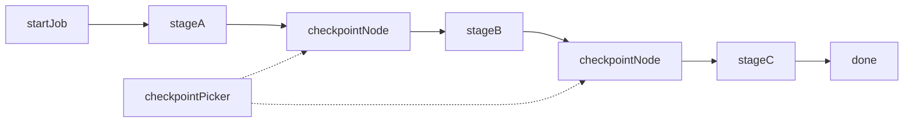

# Resumable checkpoint jobs

**Status:** Ready — resume is a workflow session. An explicit
boundary writes a point; Continue from that point. Confirmed 2026-10-17.
Auto every-node checkpoints stay off. Old checkpoint files are not read.

## Value

Operator on a long, costly **graph-shaped job** can Stop, close the UI, or
restart the process, then **pick an author-placed point** inside a workflow
session and continue without replaying work before that boundary — **not**
“keep the browser tab open,” not surprise Continue from every node
completion, and **not** soft Pause / Steer mid-turn
([run-interruption](run-interruption.md)). A workflow session is the durable
conversation (graph snapshot, transcripts, last-run work log, points). It is
not `LangflowerSession`, the process owner. Hard Stop without a boundary
still does not create resume (S3). A normal Run continues the session head;
**Continue from…** rewinds to a point.

## UX scenarios

### S1 — Author places explicit save boundaries

**Who:** Workflow author of a multi-stage job.

**Want:** Persist only at intended costly stages — not after every node.

**Do:** Insert a dedicated **checkpoint node** after costly stages
(preferred), and/or mark an output with `createCheckpoint?: boolean`
(optional advanced escape).

**Expect:**

- Boundaries MUST be author-visible on the canvas.
- Checkpoint writes MUST fire only when a boundary is crossed — MUST NOT be
  implied by every completed node.
- A human-readable label MAY be stored when the author provides one.

### S2 — Crossing a boundary persists a durable snapshot

**Who:** Operator running a job with checkpoint nodes.

**Want:** Progress before the last boundary survives Stop / sleep / crash.

**Do:** Start the run; let a stage complete through a checkpoint boundary.

**Expect:**

- While a workflow session is bound, crossing the boundary MUST append an
  immutable point on
  `.langflower/sessions/<workflowId>/<label>.json` (completed nodes,
  JSON-safe outputs, node state, feed byte offsets, fingerprint, optional label).
- With no session bound, that crossing MUST NOT write a session file or a
  `.langflower/runs/**/checkpoint.json`.
- A Run, a single-node start, or a composer cold start with no tab open
  creates and binds a session from the graph on screen before the run
  starts, so a finished run is on disk. Continue does not create a session.
- The point MUST be listed later on that session with enough identity (time,
  boundary label when present, fingerprint ok/stale).

### S3 — Stop without a boundary does not create resume

**Who:** Operator who Stops mid-stage before any checkpoint.

**Want:** No surprise Continue on trivial or mid-node stops.

**Do:** Stop (or crash) without having crossed a checkpoint boundary.

**Expect:**

- That Stop MUST NOT create a resumable checkpoint.
- UI MUST NOT offer Continue from that incomplete progress.
- (Rejected auto path: every node completion or Stop mid-Delay writing a
  checkpoint — see ADR-018 alternative C, disabled.)

### S4 — Continue from a chosen checkpoint after Stop / restart

**Who:** Operator after Stop, overnight pause, or process restart — with a
workflow session that has at least one valid point.

**Want:** Resume Stage B without redoing Stage A; choose which boundary, not
only “latest.”

**Do:** Restart, or open the workflow. The newest non-corrupt session is
already open (its snapshot on the canvas, its last run in the work log).
Open **Continue from…** and choose a point. The **Workflow** button stays
on the workflow file.

**Expect:**

- UI MUST list that session’s points (not latest-only Continue, and not
  points from another session).
- Resume MUST be `runner.resume.requested` `{ pointId }`: skip completed
  nodes before that boundary and replay JSON-safe snapshots; remaining
  stages MUST run. The work log MUST show that point’s folded feed.
- A Run on the same session MUST continue the head transcript and MUST NOT
  silently rewind to a point.
- “Continue = latest only” MUST NOT be the product contract.

### S5 — Discard or Run fresh

**Who:** Operator with stale, unwanted, or obsolete checkpoints.

**Want:** Clear control — resume, discard, or start clean.

**Do:** **Discard** a listed point, or ignore the list and **Run**.

**Expect:**

- Discard MUST remove that point (`workflowSession.discardPoint.requested`).
- Run MUST start a new run from the session head — MUST NOT silently resume
  a prior point.

### S6 — Fingerprint mismatch after editing the graph

**Who:** Operator who crossed a boundary after stage A, then edited the
session graph so its fingerprint no longer matches that point.

**Want:** A clear failure, not a wrong silent resume.

**Do:** Edit the session snapshot after a point exists; try Continue from
that point.

**Expect:**

- Fingerprint mismatch MUST surface a clear error
  (`POINT_STALE` on `runner.resume.failed`). `STALE_WORKFLOW` is not a
  resume code.
- The point stays listed as stale. **Discard** MUST remain available.

## UI specs

| Spec                                                            | Scenarios covered                                                                                                                                                                                                                                                                 |
| --------------------------------------------------------------- | --------------------------------------------------------------------------------------------------------------------------------------------------------------------------------------------------------------------------------------------------------------------------------- |
| [Visual workflow editor](../features/visual-workflow-editor.md) | [S1](#s1--author-places-explicit-save-boundaries)                                                                                                                                                                                                                                 |
| [Workflow execution](../features/workflow-execution.md)         | [S2](#s2--crossing-a-boundary-persists-a-durable-snapshot), [S3](#s3--stop-without-a-boundary-does-not-create-resume), [S4](#s4--continue-from-a-chosen-checkpoint-after-stop--restart), [S5](#s5--discard-or-run-fresh), [S6](#s6--fingerprint-mismatch-after-editing-the-graph) |

Picker / Continue draft notes live in
[workflow-execution](../features/workflow-execution.md) § Continue after Stop /
restart — no separate feature doc.

## Runtime requirements

Acid test only — if we never build it, which Expect dies?

| Need                                                               | Why (scenario)                                                                                                                                                             | Today                                                          |
| ------------------------------------------------------------------ | -------------------------------------------------------------------------------------------------------------------------------------------------------------------------- | -------------------------------------------------------------- |
| Explicit checkpoint node and/or `createCheckpoint` output meta     | Author-visible boundaries; write only on cross ([S1](#s1--author-places-explicit-save-boundaries), [S2](#s2--crossing-a-boundary-persists-a-durable-snapshot))             | **Shipped** (`common-checkpoint` + output meta)                |
| Durable store + `RuntimeRunner.resume` overlay                     | Skip completed + replay JSON-safe snapshots ([S2](#s2--crossing-a-boundary-persists-a-durable-snapshot), [S4](#s4--continue-from-a-chosen-checkpoint-after-stop--restart)) | **Shipped** — points on the session file; resume `{ pointId }` |
| Persist only at explicit boundaries (no auto node/Stop writes)     | No surprise Continue ([S3](#s3--stop-without-a-boundary-does-not-create-resume))                                                                                           | **Shipped** — and only while a session is bound                |
| Checkpoint list + resume/discard WS (multi-entry, not latest-only) | Picker Continue / Discard / Run ([S4](#s4--continue-from-a-chosen-checkpoint-after-stop--restart), [S5](#s5--discard-or-run-fresh))                                        | **Shipped** — active session’s points                          |
| Fingerprint / stale → `runner.resume.failed` + Discard             | Safe refuse after graph edit ([S6](#s6--fingerprint-mismatch-after-editing-the-graph))                                                                                     | **Shipped** (`POINT_STALE`; stale is not stored)               |

## Workflow shape

**Target** explicit-boundary spine (author places checkpoint nodes). Demo
`checkpoint-resume` is kept for redesign — **not** an end-user path today.

## Status

**Ready** (2026-10-17). The capability is a workflow session: an
explicit `common-checkpoint` / `createCheckpoint` boundary writes a labeled
point, the operator sees that session's list, and Continue from rewinds to
the point. A plain Run continues the head.

HITL and Memory inside the point payload stay out of this bar. Auto
checkpoints on every node stay off. Old
`.langflower/runs/**/checkpoint.json` files are not read.

### Missing parts

None for session points. HITL / Memory in the point payload remains later
work, not this bar.

### Workarounds

Open a workflow session, place Checkpoint nodes, and use **Continue from…**.
A Run continues the head; it does not rewind. Auto every-node Continue
remains rejected (ADR-018 C). Old checkpoint files are not a workaround.

### Demo / CI

- Demo `checkpoint-resume` — explicit Checkpoint after Stage A. Resume
  requires a workflow session; the demo graph alone does not create a point.
- Integration `tests/integration/ws/workflow-sessions.ws.test.ts`.
- Epic 20 landed the explicit boundary
  (20-explicit-checkpoints (`docs/_archive/DONE/EPICS/20-explicit-checkpoints.md`);
  infra: 14-checkpoints-resume (`docs/_archive/DONE/EPICS/14-checkpoints-resume.md`)).
  Sessions: 49-sessions (`docs/_archive/DONE/EPICS/49-sessions.md`).
- ADR: [ADR-018](../../adr/018-durable-workflow-checkpoints.md)
  (boundary) and
  [ADR-040](../../adr/040-workflow-sessions-own-points.md)
  (store).
- Architecture:
  [EXECUTION_ARCHITECTURE — Workflow session points](../../architecture/EXECUTION_ARCHITECTURE.md#workflow-session-points).
