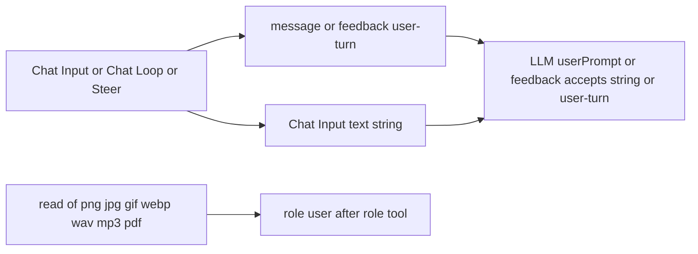

# Turn attachments

**Status:** Partial — Chat Input, Chat Loop, and Steer can attach an
allowlisted file, and `read` of those extensions stages the bytes for
Chat Completions. A live model has not been shown describing the file.
There is no browser end-to-end test.

## Value

The person attaches a picture, a short audio clip, or a PDF to a chat
turn, or names that file in the project, and the Chat Completions
request carries the bytes. This is not an asset gallery and not video.

## UX scenarios

### S1 — Attach a file and ask

**Who:** Operator on Chat Input, Chat Loop, Review Gate Request
changes, Steer, or an `ask_user` reply.

**Want:** The model receives that file with the question.

**Do:** Choose a file, paste one from the clipboard (for example a
screenshot that was never saved to disk), or drop one on the textarea.
The file's `file.type` must be `image/png`, `image/jpeg`,
`image/gif`, `image/webp`, `audio/wav`, `audio/mpeg`, `audio/mp3`, or
`application/pdf`. Type a question. Press Start or Send.

**Expect:**

- A staged image shows a tiny thumbnail. Click it for a full-size
  preview before Send. Audio and PDF show a label.
- The browser checks `file.type` before upload. An empty MIME is
  rejected. The extension does not stand in for an empty MIME. Video
  and every other type are not uploaded.
- The file is stored under that session's uploads directory. History
  stores `fileId`, not base64.
- The user bubble shows an image from
  `GET /api/session-uploads/:fileId`, or the name and MIME for audio
  and PDF. There is no player.
- Empty text does not start a turn. A file without a question does not
  start a turn.
- A textarea shows the attach control when its HITL config declares
  `attachments`. Review Gate `feedback` is a plain string with no file
  and a user turn with one.
- An `ask_user` reply may carry files. The tool message stays the reply
  text; the files follow on one `role: user` message, as for `read`.
  Text is still required.

### S2 — Name a project file in the question

**Who:** Operator with `read` wired, asking what is in a `.png`,
`.jpg`, `.jpeg`, `.gif`, `.webp`, `.wav`, `.mp3`, or `.pdf` on disk.

**Want:** Those bytes reach Chat Completions after the tool call.

**Do:** Ask in text. The model calls `read`.

**Expect:**

- `read` of those extensions stages the bytes (same 50 MB ceiling) and
  returns one text line: path, MIME, size. `ToolHandler` stays a
  string. The line does not contain base64.
- The `role: tool` messages stay text. One following `role: user`
  carries the parts, in call order. The feed does not add a human
  bubble for that message.
- The tool row shows an image via the same GET, or the name and MIME
  for audio and PDF.
- Video and every other extension stay UTF-8 and add no user message.

### S3 — Keep or drop the bytes with the session

**Who:** Operator who resets a session, or continues from a point.

**Want:** Reset removes the staged files. Continue from… still has
them.

**Do:** Reset session. Separately, continue from a point that cited
those files.

**Expect:**

- Reset deletes
  `.langflower/sessions/<workflowId>/<label>/uploads/`.
- Continue from… leaves that directory. The next turn reads the bytes
  from disk again. A point stores ids only.

### S4 — One port takes a string or a user turn

**Who:** Author of a graph that uses string prompts, user turns, or both.

**Want:** Every existing string wire keeps working, and an attachment
needs no extra port.

**Do:** Wire Chat Input `message`, Chat Input `text`, or any other
string to the LLM `userPrompt`. Wire Chat Loop `feedback`, Review
Gate feedback, or any string to `feedback`.

**Expect:**

- Chat Input `message` is `string | user-turn`: the plain string, or
  `{ text, files }` when files are attached, so string consumers wired
  before attachments keep getting a string. Chat Input `text` is always
  the question string.
- LLM `userPrompt` and `feedback` declare the wire type
  `['string', 'user-turn']`. An edge connects when the sides share a
  member, so one port takes either wire. A string means `{ text, files: [] }`.
- Graphs saved before attachments existed (Chat Input `message` into
  `userPrompt`) connect as they always did. Nothing migrates and no
  second port is shown.
- A node that declares a union must handle every member it lists.

## UI specs

| Spec                                    | Scenarios covered                                                                                                                    |
| --------------------------------------- | ------------------------------------------------------------------------------------------------------------------------------------ |
| [HITL chat](../features/hitl-chat.md)   | [S1](#s1--attach-a-file-and-ask), [S4](#s4--one-port-takes-a-string-or-a-user-turn)                                                  |
| [Feed panel](../features/feed-panel.md) | [S1](#s1--attach-a-file-and-ask), [S2](#s2--name-a-project-file-in-the-question), [S3](#s3--keep-or-drop-the-bytes-with-the-session) |

## Runtime requirements

| Need                                                                                                                                 | Why (scenario)                                                                                                                           | Today                                                                                                                                                                                                     |
| ------------------------------------------------------------------------------------------------------------------------------------ | ---------------------------------------------------------------------------------------------------------------------------------------- | --------------------------------------------------------------------------------------------------------------------------------------------------------------------------------------------------------- |
| `POST /api/session-uploads` and `GET /api/session-uploads/:fileId`                                                                   | Stage one file and show it ([S1](#s1--attach-a-file-and-ask), [S2](#s2--name-a-project-file-in-the-question))                            | Landed. Raw body, `Content-Type`, `X-Langflower-File-Name`, under 50 MB. Returns `HitlUploadedFile`. Localhost, no auth ([ADR-012](../../adr/012-internal-websocket-bus-rest-for-bulk-escape-hatches.md)) |
| Wire type `user-turn` on Chat Input `message` and Chat Loop `feedback`; LLM `userPrompt` and `feedback` accept `string \| user-turn` | The attachment survives the edge ([S1](#s1--attach-a-file-and-ask), [S4](#s4--one-port-takes-a-string-or-a-user-turn))                   | Landed. A union wire type connects on any shared member, so string graphs are unchanged                                                                                                                   |
| `read` stages in-scope bytes; the OpenAI node hoists them onto one `role: user` after the tool texts                                 | A path in the question becomes parts ([S2](#s2--name-a-project-file-in-the-question))                                                    | Landed. `ToolHandler` stays a string. Video stays UTF-8                                                                                                                                                   |
| Uploads directory beside the session                                                                                                 | Reset deletes it; Continue from… keeps it ([S3](#s3--keep-or-drop-the-bytes-with-the-session))                                           | Landed ([SESSIONS](../../reference/SESSIONS.md))                                                                                                                                                          |
| A real model that accepts the part                                                                                                   | Proof the reply describes the file, not the file name ([S1](#s1--attach-a-file-and-ask), [S2](#s2--name-a-project-file-in-the-question)) | Not run. Not part of `verify`                                                                                                                                                                             |
| Browser end-to-end of the picker                                                                                                     | Proof the person can attach in the composer ([S1](#s1--attach-a-file-and-ask))                                                           | Not in the suite                                                                                                                                                                                          |

No vision flag on the model catalog. No Responses API, Gemini, or
OpenAI Files API. No asset gallery.

## Workflow shape

String consumers can keep using `text`. The LLM `userPrompt` and
`feedback` ports accept either wire.

## Status

**Partial.** Attach on Chat Input, Chat Loop, and Steer, the `read`
hoist, the two REST routes, and the feed projection are in the
product. Unit tests and the WebSocket harness record the outbound
`messages` with a scripted chat-completion factory. That suite proves
the bytes, the JSON, and the feed. It does not prove that a model
describes the picture. It does not drive a browser.

### Missing parts

- [S1](#s1--attach-a-file-and-ask) and
  [S2](#s2--name-a-project-file-in-the-question) — **Runtime:** a
  maintainer check with a real model that accepts the part under test
  (image, `input_audio`, or PDF `file`). Record the provider and the
  model. This is not automated. Do not treat the scripted
  chat-completion factory as that check.
- [S1](#s1--attach-a-file-and-ask) — **UI:** no browser end-to-end
  test of the file picker.

### Workarounds

- A graph with a string wire on `userPrompt` still runs.

### Demo / CI

- Automated stand-in: unit tests plus
  `tests/integration/ws/execute-multimodal.ws.test.ts`. A local
  OpenAI-compatible server records the outbound `messages` for an attached
  png, a hoist round (png, wav, pdf, a text read, a video read), and a
  plain string on the same `userPrompt` port. Steer and Continue from… are covered by unit tests only.
- Not in `verify`: a live provider, and a browser pass.
- Not this scenario: an asset gallery, video, a vision flag, the
  Responses API, Gemini, or the OpenAI Files API.
